<div align="center">

# Iron Man Gauntlet — Mark 1

## A wearable Iron Man forearm and glove that flies a drone with nothing but your hand.

</div>

<p align="center">
  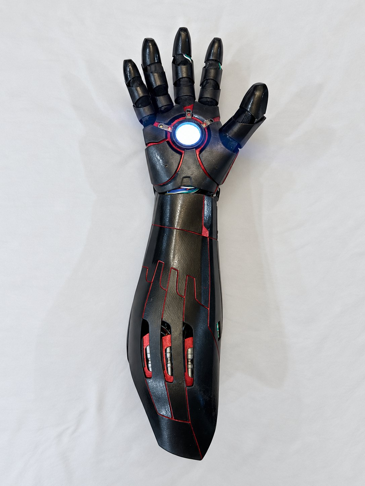
  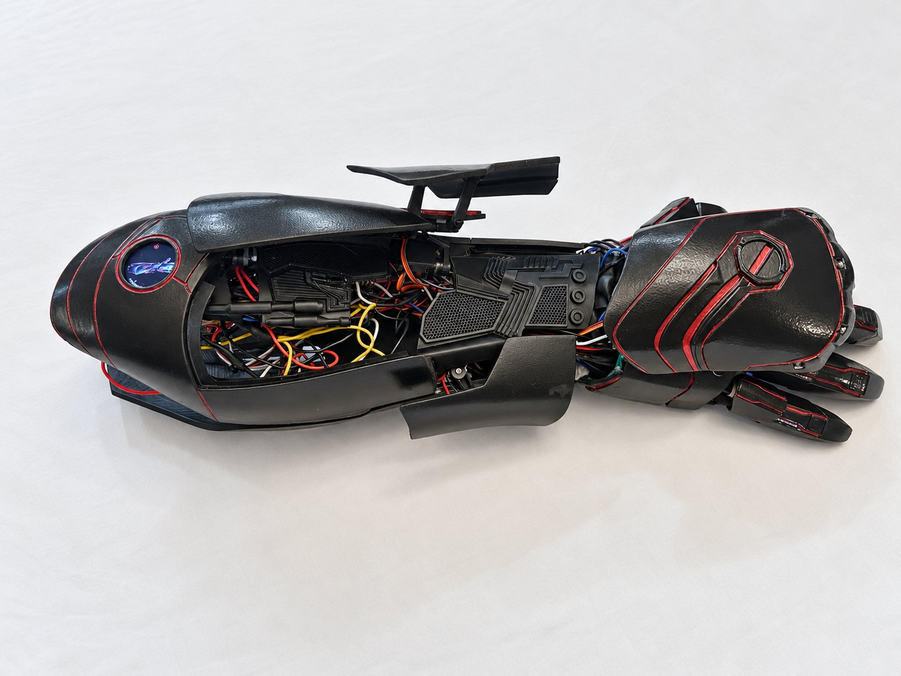
</p>

<p align="center">
  
  
  
  
  
</p>

A 3D-printed forearm gauntlet and sensor glove, run by one ESP32, that **flies a BetaFPV Air65 tiny whoop by hand gesture**: finger curl is the throttle, the wrist is the sticks, and there is no transmitter, because the arm *is* the radio. It also **opens four servo-driven armour plates in sequence**, lights a **palm repulsor**, fires a **green and a red laser**, measures distance with a **LiDAR**, shows a **thermal camera** and a **live 3D copy of the arm** on a round touch screen, and **buzzes in your hand** to confirm every gesture.

Every function is a hand gesture. No phone, computer or button needed.

---

# 🎥 Videos

> Coming soon:

- **Opening the armour** and **closing it**
- **Green laser** — the plate opens and the laser fires
- **Red laser and LiDAR** — with the distance on the screen
- **What the simulator sees** — the screen and the browser copying the real arm live
- **Drone out** — the plates open, the drone flies out, the plates close, then flying it by hand
- **Drone in** — the plates open, the drone lands, the plates close with it inside
- **All the lights**

---

# 📸 Photos

<p align="center">
  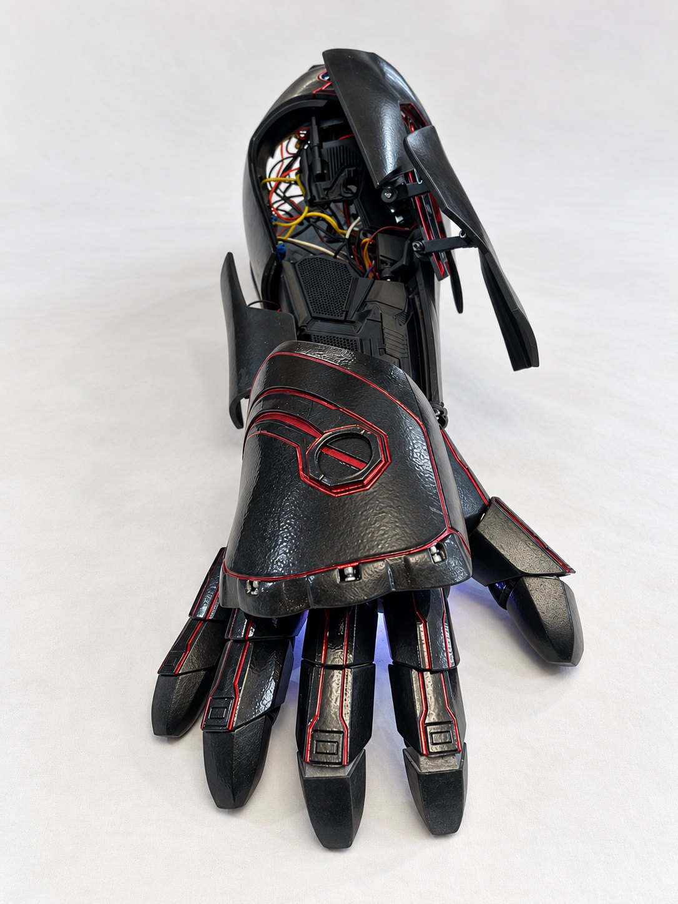
  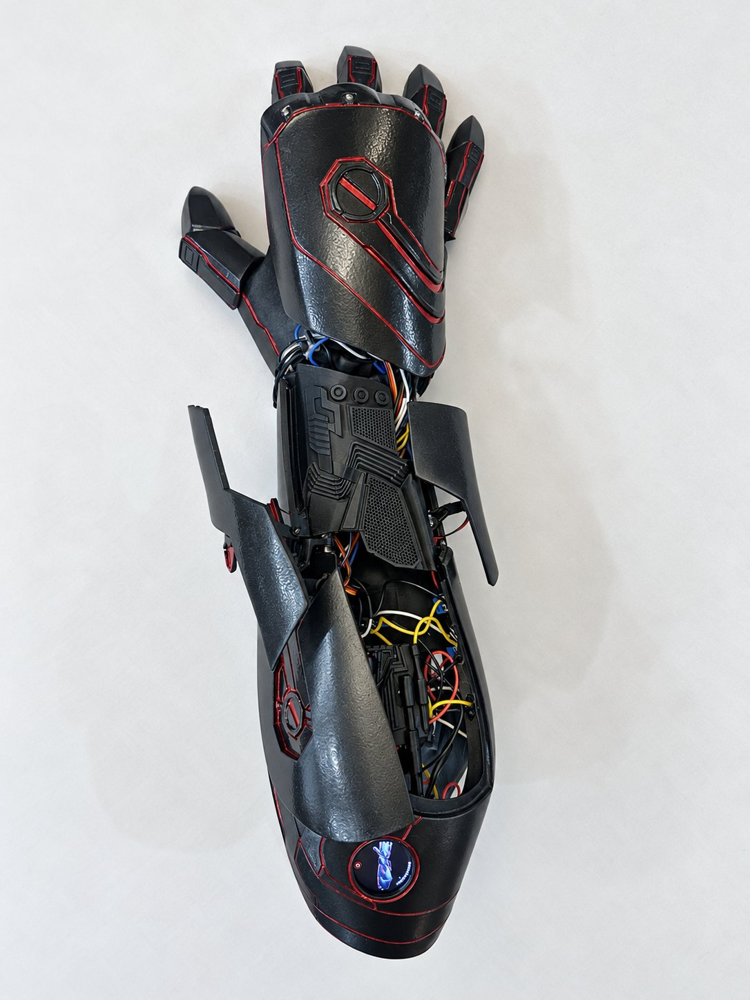
</p>
<p align="center"><b>Plates open</b>, from the front and from above. The glow under the hand is the palm light.</p>

<p align="center">
  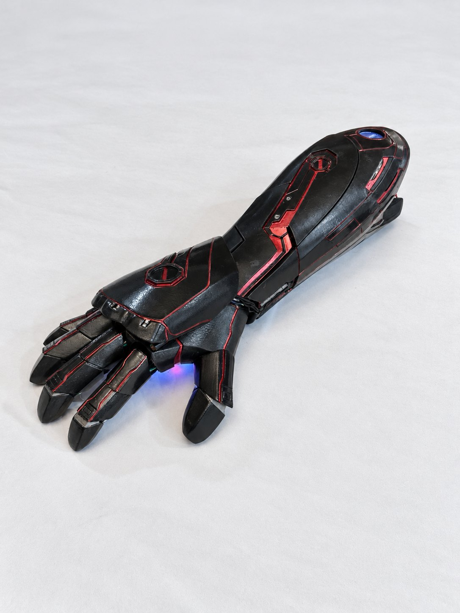
  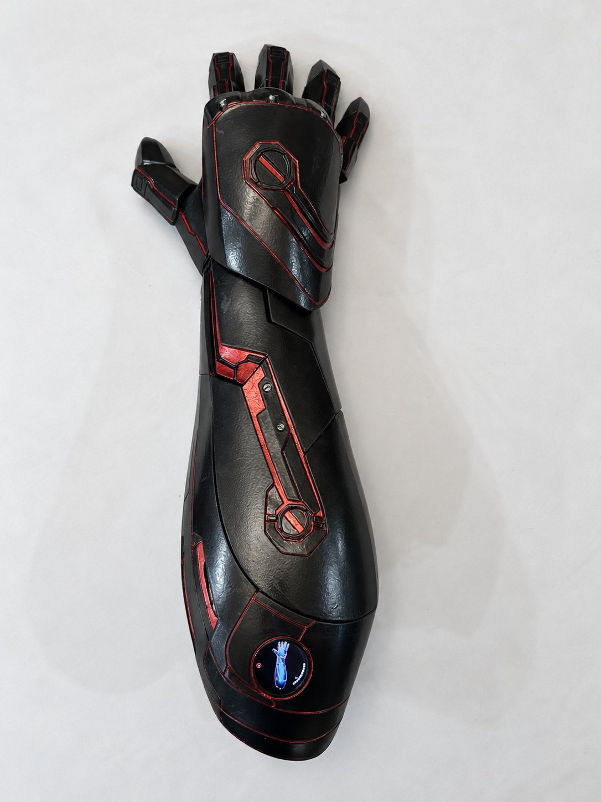
</p>
<p align="center"><b>Plates closed.</b> On the right, the round screen showing the arm in its exact pose, with the battery level.</p>

<p align="center">
  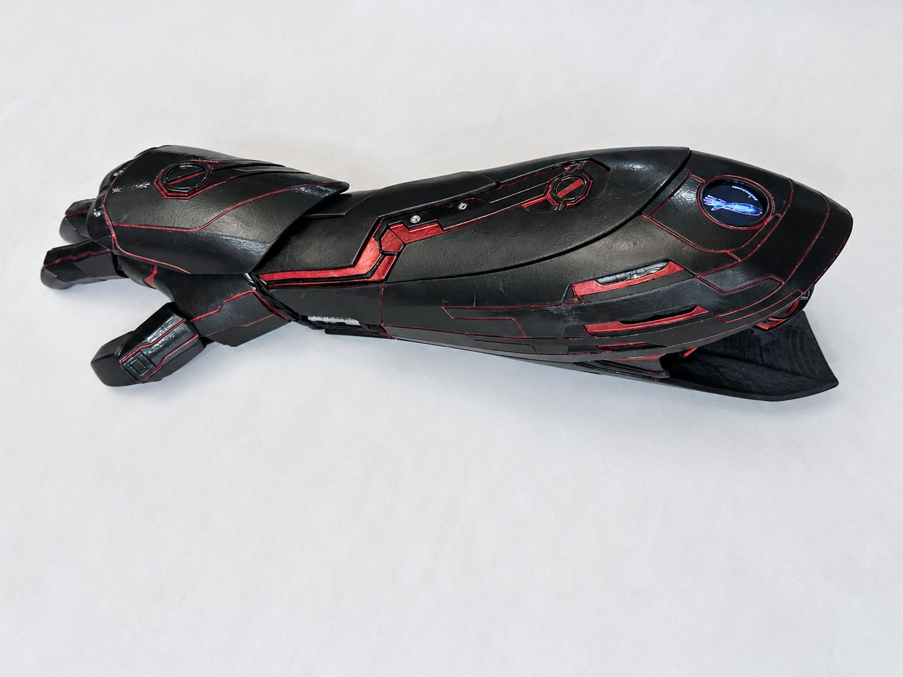
</p>

---

# 🌍 Project Background

I wanted to fly a drone with no controller at all. Not a glove that drives a transmitter, but a glove that *is* the transmitter: an ELRS radio module wired straight to the arm's ESP32 and bound to the drone.

I built the hand-flying first on a bench glove and flew the drone with it. Mark 1 runs the same flight code with better sensors and the radio built in, and adds the armour, lights, lasers and screen.

---

# 🔌 Wiring

<picture>
  <source media="(prefers-color-scheme: dark)" srcset="hardware/wiring-diagram-dark.png">
  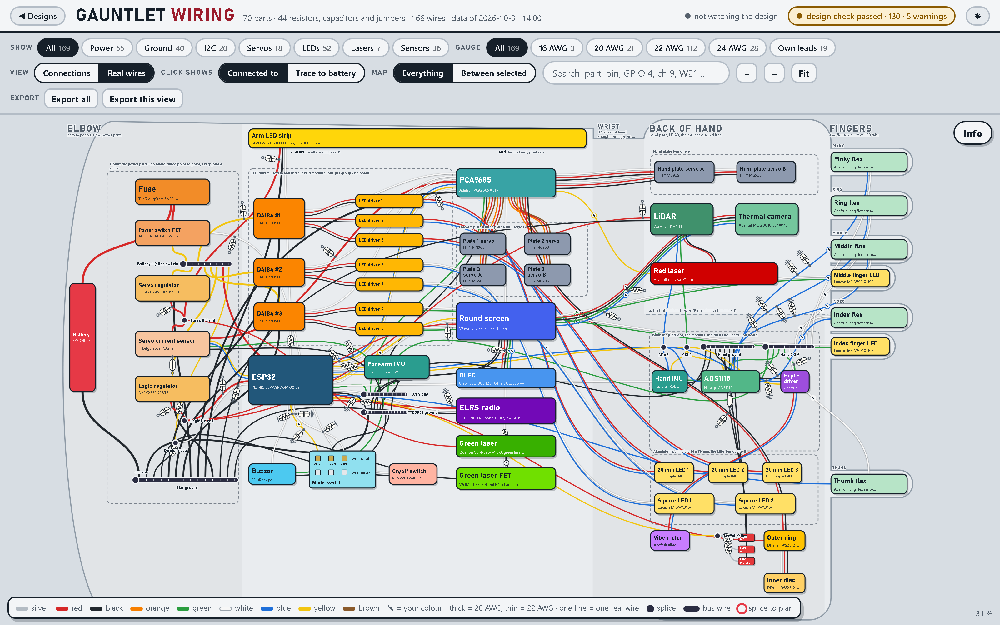
</picture>

Every part, pin and wire from the elbow (left) to the fingertips (right), each wire in its real colour: 70 parts, 166 wires, 37 of them through the wrist. I wrote an app that draws it straight from the design files, so it can't drift from the real build.

<p align="center">
  <a href="https://tobym-engineering.github.io/Iron-Man-Gauntlet-Mark-1/hardware/wiring-app.html"></a>
</p>

Click any part to see every pin and where each wire goes, or any wire for its gauge, length and current. *Trace to battery* follows a part's power all the way back. **[→ Parts, pin map and power](hardware/hardware.md)**

---

# 🧩 How It Works

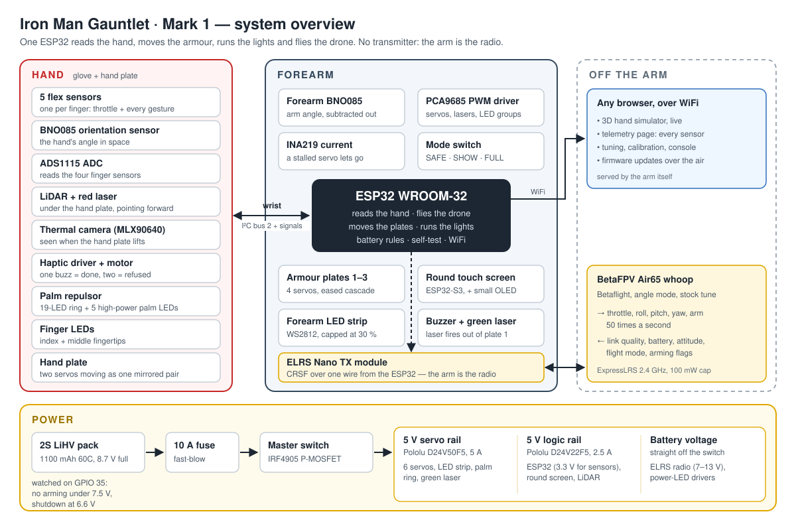

One ESP32 in the forearm does everything. The hand holds the sensors, the forearm holds the brain, the power and the drivers.

## Flying a drone with your hand

The ESP32 sends the drone stick commands **50 times a second** through a BetaFPV ELRS Nano TX on one wire, and the drone's telemetry comes back on the same wire. The drone flies in angle mode on its stock Betaflight tune.

| Stick | Comes from |
|---|---|
| **Throttle** | Finger curl: a fist descends, halfway hovers, lifting climbs |
| **Roll** | The hand's tilt |
| **Pitch** | The wrist bending up or down |
| **Yaw** | The hand turning left or right |

Two orientation sensors, one on the hand and one on the forearm, give the wrist angle *relative to the arm*. So level means level whether your arm is out in front, pointing at the floor, or your whole body is turning.

- **Arm:** thumb out, a fist, one quick pulse of the fingers. Only with the wrist in line, the switch on FULL and the battery and drone ready; if it refuses, the screen says why.
- **Disarm:** point and click the thumb twice. It also disarms itself if the link drops or the drone tips past 75°.
- **Flip-over:** if the drone lands upside down, the arm gesture flips it back over.
- **Feel:** the throttle can't jump, the hover point is learned from every flight, and neutral is wherever your hand is at lift-off.

<p align="center">
  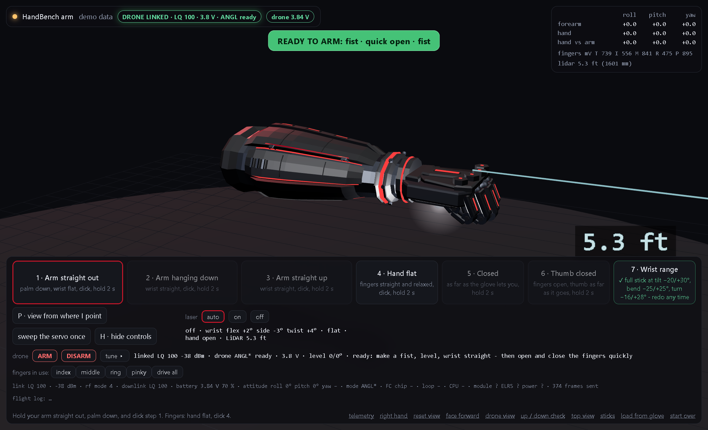
</p>
<p align="center"><i>The arm serves its own 3D simulator and telemetry page over WiFi (shown in demo mode).</i></p>

## Gestures

Every gesture needs the wrist in line with the arm, so normal movement can't set one off. **One buzz = done, two = refused.**

| Gesture | Does |
|---|---|
| Three thumb clicks, hand open / closed | Palm ring on (again: white ↔ red) / off |
| Pinky dip / index dip | Ring brighter / dimmer |
| Fist with thumb in, held, then open fast | Open every plate |
| The same fist, quick open and back | Close every plate |
| Thumb out, two quick finger pulses | Thermal camera on / off |
| Two fingers out, three thumb clicks | Green laser |
| Fist closed fast + a small wrist jolt | Red laser + LiDAR |
| Thumb out, fist, one pulse | Arm the drone |
| Point + two thumb clicks | Disarm |

A three-position switch sets what's allowed: **SAFE** (nothing acts), **SHOW** (plates, lights, camera) and **FULL** (adds the lasers and the drone).

## The round screen

<p align="center">
  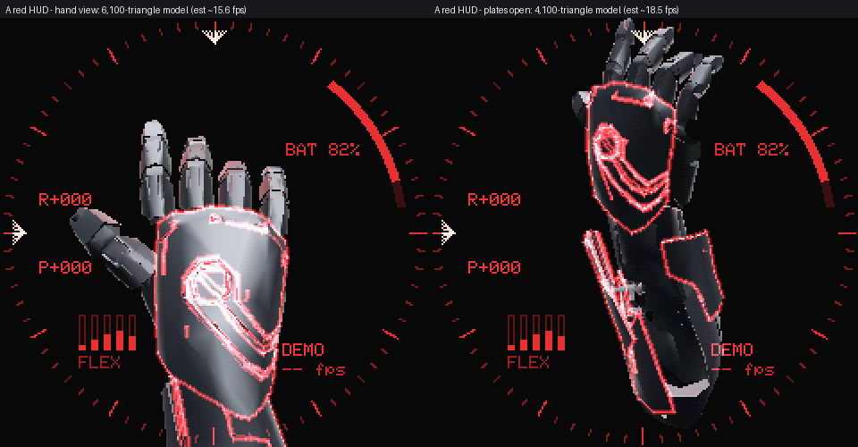
  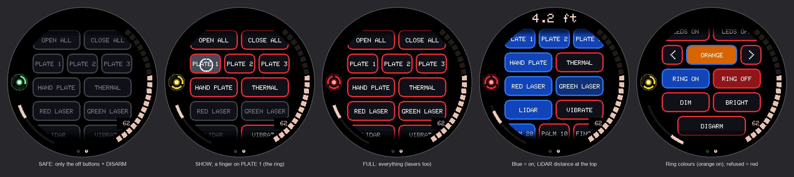
</p>
<p align="center"><i>Rendered from the screen's own code: the live 3D arm, and the control panel in SAFE, SHOW and FULL.</i></p>

An ESP32-S3 round touch display draws the gauntlet in 3D from the real CAD model, about 6,000 triangles at 16 frames a second, moving with the real arm. Swipe sideways for a control panel with a button for every action, a thermal camera page, and a six-step calibration.

## Safety

- Nothing moves at power-up, and the arm starts in SAFE
- No lasers while the drone is armed
- No arming under 7.5 V, a buzz to land at 7.3 V, full shutdown at 6.6 V
- A jammed servo is released before it burns out
- The high-power LEDs track their own heat and stop before 55 °C
- A watchdog resets the arm if the code ever hangs
- **48 self-tests** run the whole firmware with every sensor faked, on any ESP32

---

# 🛠 Hardware

| Part | Job |
|---|---|
| ESP32 WROOM-32 | The brain |
| BETAFPV ELRS Nano TX V2 | The radio, bound straight to the drone |
| BetaFPV Air65 | The drone |
| 2× BNO085 + 5× flex sensors + ADS1115 | The hand |
| PCA9685 + 6× MG90S servos + INA219 | Four armour plates, with stall detection |
| Waveshare ESP32-S3 1.28″ round display | The screen, thermal camera and OLED |
| MLX90640 · Garmin LIDAR-Lite v3 | Thermal camera · distance |
| Green 520 nm laser · red laser | Out of plate 1 · under the hand plate |
| WS2812 ring, disc and strip · 7 high-power LEDs | Repulsor, forearm, palm and fingertips |
| DRV2605L + vibration motor | The buzz in the hand |
| 2S LiHV 1100 mAh, 10 A fuse, two 5 V regulators | Power |

**[→ hardware/hardware.md](hardware/hardware.md)** has the full list, pin map and power tree.

---

# 🧠 Notable Engineering Problems

**The drone "fell out of the sky", and it was my design.** A tight fist held for a second cut the throttle for landing. It was also the "come down" squeeze, so a firm descent could trigger it. Now a fist is only ever a slow descent.

**Fifty thumb clicks to disarm.** The palm ring's click gesture was still running in flight, wiping the click history every time the disarm clicks fell into a rhythm.

**A plate that opened itself after closing.** Cutting the servo outputs mid-pulse sent a short broken pulse that threw plate 1 open. Now the outputs wait one full pulse.

**The LiDAR was a different model than its driver.** A v3 answers the v4's read with a believable number under 2.56 m, so readings that looked right were never proof.

---

# 🚀 Building It

```bash
git clone https://github.com/TobyM-engineering/Iron-Man-Gauntlet-Mark-1.git
cd Iron-Man-Gauntlet-Mark-1/firmware
cp lib/GauntletBenchIO/src/secrets.h.example lib/GauntletBenchIO/src/secrets.h   # your WiFi

./flash.sh Ironman --fake --usb COM5    # self-test, no hardware needed
./flash.sh Ironman --usb COM5           # first flash over USB (battery off)
./flash.sh Ironman                      # after that, over WiFi
./flash.sh Puck --usb COM3              # the round screen
```

Built with `arduino-cli` and the ESP32 core 3.3.x. Libraries: Adafruit NeoPixel, PWM Servo Driver, INA219, SSD1306, GFX, BusIO, MLX90640, SparkFun BNO080 1.1.12 and LovyanGFX. Every pin and limit is in `firmware/Ironman/config.h`.

---

# 📌 Repo Status

✅ Mark 1 built and running: plates, lights, lasers, LiDAR, thermal camera and screen, all from gestures

✅ Drone flown by hand on the bench glove; Mark 1 runs the same flight code with the radio built in

✅ 48 / 48 self-tests on hardware

This is my Mark 1. More versions to come.

---

# 📂 Repository Structure

```
├── firmware/
│   ├── Ironman/        the arm (ESP32)
│   ├── Puck/           the round screen (ESP32-S3)
│   ├── PuckUpdater/    the screen's WiFi update mode
│   ├── lib/            the arm-to-screen protocol, WiFi and updates
│   ├── web/            the simulator and telemetry pages
│   └── flash.sh        build and flash
├── hardware/           parts, pin map, power, diagrams and the wiring app
└── media/              photos and screen captures
```

# 📄 Licence

MIT, see [LICENSE](LICENSE).
